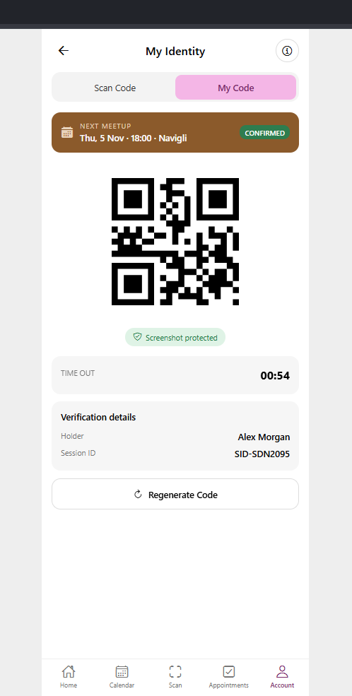

# My Identity

A small app that shows a QR code as your identity.
we built it with React Native, Expo and TypeScript.

The code expires after 60 seconds. one can tap refresh to get a new one.



## About the project

The screen follows a design mockup called QR Identity.
Everything lives in one file, App.tsx, for now.
The QR value is a dummy token made in the app.
Later it should come from a real backend.

Main parts used:
- react-native-qrcode-svg for the QR code
- @expo/vector-icons for the icons
- react-native-web to run it in the browser

## What the code does

1. The app starts in the expired state.
2. A new session ID and token are made on refresh.
3. The QR code is built from that token.
4. A 60 second countdown starts after each refresh.
5. At 00:00 the QR fades and a lock card appears.
6. Tap to refresh or Regenerate Code brings it back.
7. Scan Code and My Code tabs switch the view.
8. The meetup card and holder details are fixed text.
9. The bottom bar only changes the highlighted tab.
10. Styles are kept in one StyleSheet at the bottom.

## Run it

Install the packages first.

```
npm install
```

Then start the app.

```
npx expo start
```

Press `w` to open it in the browser.

## Run on your phone

Install Expo Go on your phone. Use the same Wi-Fi as your laptop.
Scan the QR code from the terminal.

If it does not connect, try this.

```
npx expo start --tunnel
```

